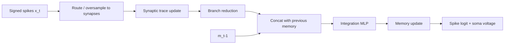
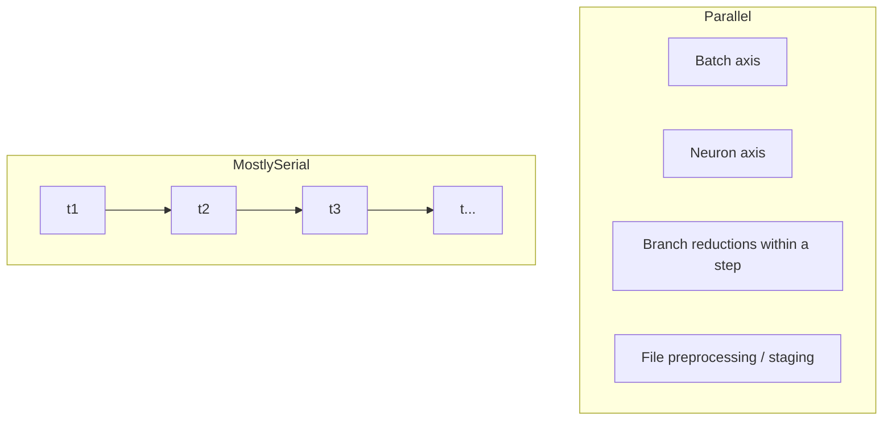
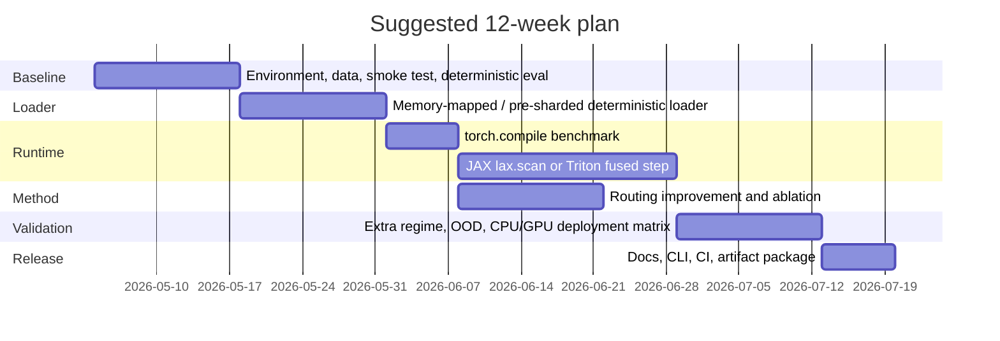

# Improving Branch-ELM as a Deployable Surrogate for Detailed Biophysical Neuron Models

## Executive summary

The strongest current public starting point is **not** the original TCN and probably not a larger vanilla ELM; it is **Branch-ELM with about 20–30 memory units**, because that is where the public efficiency–accuracy trade-off is already best. In the official appendix tables, **Branch-ELM-30** reaches **0.628 ± 0.002 soma RMSE** and **0.9927 ± 0.0001 spike AUC** with **11.1K parameters** and **21.3M FLOPs/sample**, while vanilla **ELM-75** reaches the same **0.9927 AUC** with only a small RMSE improvement to **0.622 ± 0.004**, but needs **214.95K parameters** and **217.58M FLOPs/sample**. That makes Branch-ELM-30 the best public “X” if the criterion is “better speed/size without a significant loss in accuracy.” citeturn44view5

This is a real contribution opportunity, but the strongest version of it is **systems + method**, not “one more NeuronIO ablation.” The public code path still has obvious deployment and reproducibility gaps: the forward pass is an explicit recurrent time loop, the public NeuronIO loader is explicitly documented as **highly nondeterministic** under multiple workers, the training script requires manual path and W&B edits, and the repo itself says the **PyTorch implementation is about 2× slower than the JAX version**. That means there is likely substantial room for a contribution built around a deterministic loader, compiled recurrent execution, fused kernels, sparse/event-aware front-end updates, and a routing mechanism that is less tied to NeuronIO’s exact input ordering. citeturn43view0turn38view0turn12view0turn24view1

The concrete recommendation is to build around **Branch-ELM-30 as the reference baseline**, then pursue three deliverables in order: **a one-command reproducible baseline**, **a faster runtime path**, and **a routing improvement that keeps most of the efficiency benefit while weakening morphology-specific assumptions**. If you do that, the project becomes publishable or thesis-worthy even before you attempt a large new evaluation campaign. citeturn44view5turn44view0turn42view1

## Priority literature, codebases, and artifacts to use first

The primary sources to start from are the original TCN benchmark by entity["people","David Beniaguev","computational neuroscientist"], entity["people","Idan Segev","computational neuroscientist"], and entity["people","Michael London","neuroscientist"]; the ELM / Branch-ELM work from entity["people","Aaron Spieler","ml researcher"]; the NeuronIO public data artifacts on entity["company","Kaggle","data science platform"]; and the adjacent LFDeep work from entity["people","Jonas Verhellen","computational neuroscientist"]. The official code is on entity["company","GitHub","code hosting platform"], and the paper-reported training hardware is single-entity["company","NVIDIA","gpu vendor"] A100-class hardware. citeturn40view5turn24view1turn35search1turn31view0

### What to open first and why

| Priority | Source | Use it for | Public artifacts available | Direct source links |
|---|---|---|---|---|
| First | Original TCN benchmark repo and paper | Ground-truth benchmark, simulator lineage, dataset format, replication logic | paper, repo, simulator code, training script, evaluation scripts, Kaggle train data, Kaggle test data + pretrained networks, notebook replicating main result | repo + paper + data + notebook citeturn40view5turn40view6turn25search3 |
| First | ELM / Branch-ELM repo | Fastest path to a working baseline and pretrained checkpoints | MIT-licensed repo, pretrained Branch-ELM models, one best-effort ELM checkpoint, train/eval notebooks, environment files, training script | repo + README + env files citeturn24view1turn39view0 |
| Second | ELM / Branch-ELM paper | Canonical accuracy/FLOP/parameter tables and training details | appendix tables, training setup, hardware note, ablation results | paper citeturn31view0turn44view5 |
| Third | LFDeep repo and paper | Adjacent benchmark for full-compartment voltage prediction | MIT-licensed repo, checkpoints, Kaggle data, configs, environment | repo + paper + data statement citeturn35search0turn35search1turn35search4 |
| Supporting | Original dataset metadata pages | Licensing and hidden artifact inventory | CC BY 4.0 dataset metadata, references to evaluation CSVs and Kaggle assets | metadata pages citeturn25search2turn25search4 |

The original TCN repo is unusually helpful: it explicitly links the Neuron paper, the open-access preprint, the Kaggle **train dataset**, the Kaggle **test dataset and pretrained networks**, a **main-result notebook**, and the simulator plus TCN training/evaluation scripts. That makes it the right place to understand the end-to-end benchmark and data lineage before changing anything. citeturn40view5turn40view6

The ELM repo is the right place to actually start implementation because it already ships environment files, pretrained models, notebooks, and a training script. The README states that the repo contains **pre-trained Branch-ELM neuron models** across multiple sizes and also a **best-effort trained ELM neuron**. It also explicitly says the visible PyTorch implementation is **about 2× slower than the JAX version**, which is exactly the kind of systems gap that supports a concrete contribution. citeturn24view1

LFDeep is not your baseline, but it is your best adjacent reference. Its paper and repo are important because they show that public surrogate work has already moved beyond soma-only prediction toward **all-compartment voltage prediction**, with code and checkpoints available. That matters because it is the clearest neighboring direction in which “deployable surrogate” could evolve after a Branch-ELM systems paper. citeturn35search1turn35search4

### Candidate model comparison

| Model | Architecture | Trainable params | FLOPs / sample | Soma RMSE | Spike AUC | Artifact availability | Source |
|---|---|---:|---:|---:|---:|---|---|
| TCN baseline | 7 causal Conv1D layers, 128 feature maps/layer, kernel 35, plus spike/soma heads and 20 dendritic-voltage components | **~9.17M** *(estimate)* | **~9.17 GFLOPs** *(estimate; 1 MAC = 2 FLOPs)* | exact best-row value not surfaced here | threshold-level around **0.991** | official repo, data, pretrained nets, replication notebook | architecture + artifacts citeturn40view5turn23view1turn24view2 |
| ELM-20 | recurrent ELM, 20 memory units | 52.92K | 55.38M | 0.643 ± 0.004 | 0.9918 ± 0.0002 | official paper + repo | citeturn44view5turn24view1 |
| ELM-50 | recurrent ELM, 50 memory units | 138.3K | 140.85M | 0.629 ± 0.002 | 0.9925 ± 0.0002 | official paper + repo | citeturn44view5turn24view1 |
| ELM-75 | recurrent ELM, 75 memory units | 214.95K | 217.58M | 0.622 ± 0.004 | 0.9927 ± 0.0001 | official paper + repo | citeturn44view5turn24view1 |
| Branch-ELM-20 | branch-factorized recurrent model, 20 memory units | 8.1K | 18.27M | 0.638 ± 0.003 | 0.9924 ± 0.0002 | official paper + repo | citeturn44view5turn24view1 |
| Branch-ELM-30 | branch-factorized recurrent model, 30 memory units | 11.1K | 21.3M | 0.628 ± 0.002 | 0.9927 ± 0.0001 | official paper + repo | citeturn44view5turn24view1 |
| Branch-ELM tiny | simplified branch version | 5.329K | not surfaced in same table | 0.66 | 0.9915 | official paper | citeturn44view2 |
| Repo best-effort ELM checkpoint | repo-only summary, d_m = 100 | repo model | README does not report | README does not report | 0.9946 | official repo | citeturn24view1 |

For your project, the most useful public baseline is **Branch-ELM-30**, not because it is the absolute best AUC checkpoint in every source, but because it is the cleanest public Pareto point. It matches **ELM-75** on AUC and is within **0.006 mV RMSE**, while using roughly **19× fewer parameters** and about **10× fewer FLOPs/sample**. That is the right operating point if the goal is “efficient, parallelizable, deployable.” citeturn44view5

### Explicit estimate for the TCN baseline

The original public TCN code and paper snippet make the core architecture visible: **7 layers**, **128 feature maps per layer**, **kernel size 35**, causal 1D convolutions, and three output heads for spike, soma voltage, and **20 dendritic-voltage outputs** in the NMDA case. Using that public architecture, the parameter estimate is:

- first conv: `35 × 1278 × 128 + 128 = 5,725,568`
- next 6 convs: `6 × (35 × 128 × 128 + 128) = 3,441,408`
- output heads: `128×1+1 + 128×1+1 + 128×20+20 = 2,838`
- trainable BatchNorm affine terms: `7 × 2 × 128 = 1,792`

So the total is about **9,171,606 parameters**, which matches the follow-up paper’s repeated description of the TCN as “around 10M parameters.” For a **500-step** sample, the dense forward-pass MAC estimate is:

- first conv: `500 × 35 × 1278 × 128 ≈ 2.86B MACs`
- next 6 convs: `6 × 500 × 35 × 128 × 128 ≈ 1.72B MACs`
- output heads: ~`1.4M MACs`

Total: about **4.58B MACs/sample**, or about **9.17 GFLOPs/sample** if `1 MAC = 2 FLOPs`. This is an estimate derived from the public architecture, not a paper-reported table value. citeturn40view5turn23view1

## Reproducibility cost and concrete baseline steps

### Step-by-step baseline plan

The shortest credible path is to **start from pretrained Branch-ELM evaluation**, not full training. Do this first:

```bash
git clone https://github.com/AaronSpieler/elmneuron
cd elmneuron
conda env create -f elm_env_gpu.yml
conda activate elm_env_gpu

# Download the public NeuronIO assets referenced in the README
kaggle datasets download -d selfishgene/single-neurons-as-deep-nets-nmda-train-data
kaggle datasets download -d selfishgene/single-neurons-as-deep-nets-nmda-test-data

# unpack them into your local train/test folders
# then start with the provided evaluation notebook
jupyter lab
```

Those commands are directly supported by the public repo structure and environment files. The repo ships `elm_env_gpu.yml`, `models/`, `notebooks/`, and the NeuronIO evaluation notebook specifically for running provided models on the public dataset. citeturn24view1turn39view0

After that, make the training path work in the public script. The specific edits you should expect are in `notebooks/neuronio_train_script.py`: `package_path`, the train and test directory `Path(...)` placeholders, and the W&B fields (`api_key_file`, `project`, `group`, `job_type`). The script also assumes a NeuronIO folder layout in which `full_ergodic_train_batch_1` is held out for validation and the remaining numbered train batches are used for training. citeturn12view0

Only after the eval path is working and the training script launches should you touch the original TCN repo. That code is still essential as a scientific reference, but it is clearly a legacy reproduction path: it imports standalone `keras`, uses hard-coded absolute directories like `/Reseach/Single_Neuron_InOut/...`, and sets `use_multiprocessing = False` with `num_workers = 1`. Those are immediate signals that it is the right source for **benchmark semantics**, not for your day-to-day optimization loop. citeturn17view0turn17view5

### Public training configurations you should reproduce first

The paper-faithful ELM/Branch-ELM NeuronIO schedule is: **500 ms samples**, **1 ms bins**, **batch size 8**, **30 epochs**, **11,400 batches per epoch**, **Adam**, **cosine-decay schedule**, equal weighting of **BCE for spikes** and **MSE for soma voltage**, with loss computed after a **150 ms burn-in**, and runs reported on a single A100-class GPU in **less than 24 hours**. That is the training configuration you should target first when you want a baseline that matches the paper rather than “just a working public script.” citeturn31view0turn31view2turn31view5turn31view6

The public repo script is slightly different: the default full-run config uses **35 epochs**, a base learning rate of `5e-4`, **10 workers**, **100 prefetched batches**, and a **500-step input window**. It also builds the NeuronIO data loader with explicit multiprocessing queues. This is close enough to be practical, but not identical, so record carefully whether your baseline is **paper-faithful** or **repo-faithful**. citeturn10view0turn10view1turn10view5turn37view0turn37view3

### Compute, memory, and storage budget

The public constants make the data path large even though the model is small. The NeuronIO constants in the repo are **1278 input channels**, **2 labels**, **6000 time steps per simulation**, and **128 simulations per file**; the README says the NeuronIO-related code requires about **115 GB** of downloaded data. For practical work, I would budget **180–250 GB** of free SSD space, not 115 GB, because you will also want unpacked data, logs, checkpoints, and experiment outputs. That storage target is an estimate, but a realistic one. citeturn16view0turn24view1

The most useful planning numbers are the batch tensors. At the public default training shape of `batch_size=8`, `input_window_size=500`, and `input_dim=1278`, a dense float32 input batch is:

- `8 × 500 × 1278 × 4 bytes = 20,448,000 bytes ≈ 19.5 MiB`

The labels add almost nothing by comparison:

- `8 × 500 × 2 × 4 bytes ≈ 0.03 MiB`

Because the public loader uses a queue and a local buffer with **100 prefetched batches**, that alone can stage roughly:

- `100 × (19.5 + 0.03) MiB ≈ 1.95 GiB`

before counting worker-local arrays and copies. That is why I would recommend **64 GB RAM** if possible, **32 GB minimum**, and a GPU with **12–16 GB VRAM minimum** or **24 GB comfortable**, especially if you initially keep the public loader behavior. These memory figures are explicit estimates derived from public tensor shapes and queue settings. citeturn37view0turn37view1turn37view3turn37view5

A reasonable hardware planning template is therefore:

| Resource | Minimum workable | Recommended | Why |
|---|---|---|---|
| SSD storage | 180 GB free | 250 GB+ NVMe | dataset + unpacking + checkpoints |
| RAM | 32 GB | 64 GB | public loader uses multiple workers and deep prefetch |
| GPU VRAM | 12–16 GB | 24 GB | model is small, but the current input / prefetch path is not |
| CPU | 8 cores | 12–16 cores | file parsing, decompression, loader workers |

These are implementation-planning estimates, not paper-stated minimums, and they assume you keep the current dense loader path at first. citeturn37view0turn37view3turn24view1

### Estimated wall-clock times

The only directly published runtime statement you should treat as hard evidence is that the paper’s experiments ran on a single A100 or A100-80GB and finished in **less than 24 hours**. Everything else below is an estimate for planning. citeturn31view0

For **pretrained evaluation**, the safest concrete plan is: budget **under 30 minutes for a smoke test** on a subset and **1–4 hours for a first full public test evaluation** on a single modern GPU with local NVMe, because evaluation avoids backprop but still inherits the public sliding-window and recurrent execution path. For **Branch-ELM training**, budget **8–24 hours on A100-class hardware** and **12–36 hours on 3090/4090-class hardware** as a realistic first-pass planning range. For the **original TCN retraining path**, budget **1–3 days** on a modern GPU because the public code is both larger and more legacy-bottlenecked. Those are engineering planning ranges, not published measurements. citeturn31view0turn17view5turn18view3

### Common confounds and missing pieces

The most important confound is that the public NeuronIO loader is explicitly described as **highly nondeterministic** with multiple workers, even when seeded. If you want credible latency or reproducibility claims, you should fix that before reporting anything ambitious. citeturn38view0

The second confound is manual configuration friction. The public training script requires path edits and W&B setup before it will run cleanly. That is not fatal, but it means a large part of your “reproducibility contribution” can be won simply by removing fragile path and logging assumptions. citeturn12view0

The third confound is benchmark mismatch between sources. The original TCN public code trains with a three-output objective that includes dendritic voltage components, while the public ELM repo’s NeuronIO loss is just **BCE + MSE** over spikes and soma, equally weighted. That does not invalidate comparisons, but it means cross-paper claims should be written carefully and not overstated as apples-to-apples optimization of the exact same training objective. citeturn23view1turn23view2turn20view0

## Practical barriers, evaluation gaps, and scientific risk

The biggest scientific barrier is still **scope**. The public evidence is excellent for one detailed layer-5 pyramidal-cell family and its public benchmark, but that is not yet the same as a broad claim about detailed biophysical neuron surrogates in general. The original TCN repo says the fitted DNN generalized well to inputs “widely outside the training distribution,” but that claim remains inside one simulator lineage rather than across many morphologies or cell classes. citeturn40view5

The biggest Branch-ELM-specific barrier is **morphology-dependent routing**. In the public implementation, `neuronio_routing` interlaces excitatory and inhibitory inputs, groups neighboring inputs into overlapping branch windows, and relies on the ordering in the input channels. The paper itself states that violating this assumption leads to performance deterioration. That is exactly why a routing-focused improvement is a high-value contribution: it attacks a known weakness instead of merely tuning the memory size. citeturn42view1turn42view2turn44view0

The next barrier is **recurrence over time**. The public `forward` method routes the full input, then loops over `t = 1...T`, updates recurrent state, and stacks the outputs. That means exact time-parallelization is fundamentally limited; the natural parallel axes are **batch**, **neuron**, and some **branchwise work within a step**, not the whole time dimension. So claims about “parallelizable surrogate neurons” need to be framed carefully: what you can parallelize well is **many neurons/windows at once**, not arbitrary time steps of one recurrent trajectory. citeturn43view0turn43view1

Event sparsity is both an opportunity and a limitation. The NeuronIO inputs are signed sparse spike channels, and Branch-ELM first applies **synaptic trace updates** and only then a **branch reduction + nonlinear recurrent memory update**. That means sparse/event-aware execution is most natural in the routing and synaptic front-end. It is much harder to skip the whole recurrent computation exactly once the nonlinear memory update is involved. So the right design target is probably a **hybrid sparse–dense runtime**, not a purely event-driven exact simulator. citeturn16view0turn42view1turn43view0

### Minimal non-core evaluation needed to make claims credible

A credible contribution does **not** need a giant new dataset, but it does need more than the stock NeuronIO split. The best minimum bundle is:

1. **One extra synaptic regime** from the original benchmark family, ideally **AMPA** or **AMPA without SK**, because the original code already encodes these conditions.  
2. **One routing-stress suite**, such as input-channel permutation, different branching layouts, or a routing learned from morphology rather than NeuronIO order.  
3. **One OOD stimulus suite**, for example altered synchrony, E/I ratio changes, burstiness changes, and long silent periods.  
4. **One deployment benchmark matrix**, covering CPU and GPU at batch size 1 and one larger batch size. citeturn23view0turn40view5turn44view0

This is not prohibitively expensive. Extending within the public AMPA / AMPA-SK / NMDA family is fairly tractable because the original code and dataset logic already anticipate those cases. What becomes expensive is a true **cross-morphology** benchmark, because data generation with NEURON becomes the dominant cost rather than surrogate training. So for a thesis or first paper, I would **not** start with “many morphologies”; I would start with **one extra regime + one routing stress test + one OOD suite**. citeturn23view0turn40view6

### Risks and failure modes

The main failure modes are concrete. One is **overfitting to NeuronIO’s ordering and statistics**. Another is **benchmark leakage through morphology-specific routing**. A third is **metric narrowness**: a model may look excellent on AUC and soma RMSE while still behaving poorly on low-false-positive spike operating points, rare burst events, or long-silence edge cases. A fourth is **energy–latency tradeoff inversion**: sparse or branchwise optimizations can reduce arithmetic counts while creating control-flow overhead that hurts batch-1 latency. Those are exactly the risks your project should address explicitly. citeturn44view0turn22view4

## Systems opportunities and concrete optimization steps

The public Branch-ELM structure already reveals the optimization targets very clearly. Each time step computes a synaptic trace update, branch reduction, MLP-based integration, recurrent memory update, and a linear readout. In the public code, these are called inside a Python/TorchScript loop over time and the outputs are appended to a list then stacked. This is the strongest possible signal that the first engineering wins are **compiled recurrence** and **kernel fusion**. citeturn42view1turn42view3turn43view0



The public code path corresponds closely to the diagram above: route input, update synaptic traces, sum to branches, concatenate with memory, apply the MLP, update the recurrent memory, then read out spike and soma outputs. citeturn42view1turn42view3turn43view0

### Exact places to optimize first

The highest-value sequence is:

1. **Replace the current loader path** with a deterministic, memory-mapped or pre-sharded path.  
2. **Keep the math unchanged** and benchmark it under PyTorch 2 with `torch.compile`.  
3. **Move to a compiled recurrent scan** in JAX with `lax.scan` or a fused PyTorch/Triton step.  
4. **Only then** add sparse/event-aware logic and routing experiments.  

That order matters because if you start with sparse kernels before fixing the loader and compile path, you may optimize the wrong bottleneck. The public loader is currently likely to contaminate all runtime conclusions. citeturn38view0turn37view3turn24view1

### Where to fuse operations

The most natural fusion unit is **one recurrent time step**. Specifically, you want one compiled kernel or one tightly fused function that performs:

- `s_t = kappa_s * s_prev + w_s * x_t`
- branch reduction `syn_input = reshape(s_t).sum(...)`
- feature concat with `kappa_m * m_prev`
- MLP forward
- memory update
- output projection

In the public code, those pieces already appear adjacent inside `dynamics(...)`, which makes this a clean target for a fused step implementation rather than a speculative redesign. citeturn42view1turn42view3

### Parallelization map

| Axis | Parallelizable? | Practical value | Notes |
|---|---|---|---|
| Batch / window | Yes | High | easiest win immediately |
| Independent neurons | Yes | High | crucial for throughput deployment |
| Branchwise reductions within one step | Yes | Moderate to high | natural target for fused kernels |
| Time steps of one recurrent trajectory | Limited | Low to moderate | exact full parallelization blocked by recurrence |
| File loading / preprocessing | Yes | High | but must be made deterministic |

This parallelization map follows directly from the public implementation: the per-time-step update is recurrent, but the batch/neuron/branch work is naturally parallel. citeturn43view0turn42view1



The public `for t in range(T)` loop is the primary reason exact time parallelization is limited. citeturn43view0

### Speedup estimates and explicit assumptions

The estimates below are **engineering planning ranges**, not paper-reported numbers. They assume a modern CUDA stack, a local NVMe SSD, and that the current public bottlenecks are a mix of loader overhead, many small GPU launches, and a recurrent loop.

| Optimization | Concrete action | Estimated practical speedup | Why the range is plausible |
|---|---|---:|---|
| Deterministic memory-mapped loader | pre-shard / mmap NeuronIO, remove repeated reparsing, reduce queue depth | **1.5×–4×** end-to-end training throughput | current loader reparses large files and stages deep queues |
| PyTorch 2 `torch.compile` | compile the current math before redesign | **1.2×–2×** | low engineering cost; mainly reduces framework overhead |
| JAX `lax.scan` recurrent path | move the step loop into a compiled scan | **1.5×–3×** | repo itself says the visible PyTorch code is ~2× slower than JAX |
| Triton / CUDA fused step | fuse trace update + branch sum + MLP input prep + memory update + readout | **2×–5×** | eliminates many tiny kernels and intermediate writes |
| Mixed precision | `bf16` or `fp16` recurrent state and MLP | **1.1×–1.8×** | useful mostly after compilation/fusion |
| Event-aware sparse front-end | lazy synaptic decay + sparse route/update before dense memory step | **2×–10×** on sufficiently sparse workloads | NeuronIO inputs are spike-event channels, but recurrence limits exact skipping |
| Multi-neuron batching | benchmark batch-1, 16, 64, 256 | **throughput 5×–50×**, latency smaller gain | natural deployment win for populations |

The JAX speedup range is justified directly by the repo statement that the PyTorch version appears about **2× slower than the JAX version**. The other ranges are based on the public code structure and the common behavior of recurrent, small-kernel GPU workloads. citeturn24view1turn43view0turn42view1

### Automation potential

Most of the engineering pipeline can be automated. Hyperparameter search over `num_memory`, `num_branch`, `num_synapse_per_branch`, routing type, timescale bounds, and update strength is straightforward. Routing search is also a plausible NAS target because the structure is narrow and discrete: fixed grouped routing, morphology-informed routing, or learned grouped routing are all manageable search spaces. Kernel autotuning can be automated if you use Triton, and CI can enforce reproducibility checks, latency envelopes, environment lock files, and checkpoint sanity tests. citeturn42view2turn24view1

What still requires human judgment is the scientific side: deciding which OOD benchmarks are meaningful, deciding when routing structure is a legitimate prior rather than benchmark exploitation, and deciding whether event-driven approximations preserve the right neuronal behaviors beyond headline AUC and RMSE. Those decisions should stay human-in-the-loop. citeturn44view0turn22view4

## Recommended project plan, milestones, and concrete next steps

### Recommended project shape

The best-scoped project is:

- **Baseline artifact:** one-command deterministic Branch-ELM reproduction on public NeuronIO.  
- **Systems artifact:** faster runtime path, ideally with a deterministic loader and a compiled or fused recurrent core.  
- **Method artifact:** a routing variant that is less brittle than pure NeuronIO-order routing.  
- **Minimal validation:** one extra public synaptic regime, one routing-stress suite, and one CPU/GPU deployment benchmark.  

This keeps the project from becoming “mostly an evaluation paper” while still making the claims credible. citeturn44view0turn23view0

### Milestones



This timeline is realistic for one strong ML/systems researcher with part-time neuroscience guidance, and it keeps the high-risk method work behind a lower-risk baseline and systems path. citeturn24view1turn35search1

### Resource estimate

| Item | Budget |
|---|---|
| Personnel | 1 ML/systems engineer or thesis student, plus occasional neuroscience supervision |
| Compute for core project | 1 modern CUDA workstation |
| GPU planning target | 12–24 GB VRAM, preferably more if you keep the public loader design initially |
| Storage | 180–250 GB fast SSD |
| Calendar time | 10–12 focused weeks |
| Training budget | several baseline runs plus profiling sweeps; same-day turnaround per run on good GPU is realistic planning |

These planning numbers follow from the public dataset size, the under-24h A100 training note, and the current public loader/runtime design. citeturn24view1turn31view0turn37view3

### Success criteria

Use concrete targets, not vague improvement claims. I recommend:

- **Accuracy target:** keep within **0.001 AUC** and **0.02 mV RMSE** of public Branch-ELM-30, or improve slightly.  
- **Latency target:** achieve **≥3×** lower batch-1 latency or clearly document why the work is instead a throughput optimization.  
- **Throughput target:** achieve **≥5×** higher throughput at moderate batch sizes.  
- **Memory target:** cut peak memory staging materially, ideally by **2×** or more.  
- **Reproducibility target:** deterministic evaluation and CI-backed metric reproducibility.  
- **Robustness target:** no catastrophic collapse on at least one routing perturbation and one extra public regime.  

Those targets are aggressive enough to matter while still being realistic for a systems-first project built on the current public artifacts. citeturn44view5turn38view0turn23view0

### Immediate next steps

If you wanted to start tomorrow, I would do exactly this:

1. **Run the public pretrained Branch-ELM evaluation notebook** unchanged, and save the metric outputs.  
2. **Delete nondeterminism from the eval path** before touching training.  
3. **Profile loader time vs model time** with the current repo.  
4. **Establish Branch-ELM-30 as the locked baseline.**  
5. **Try `torch.compile` first**, because it is the cheapest runtime experiment.  
6. **Then implement either JAX `lax.scan` or a fused Triton recurrent step.**  
7. **Only after that**, test a routing change.  

That order is the shortest path to a specific, defensible result. citeturn24view1turn38view0turn44view5

### Short implementation checklist

- [ ] Clone the official ELM repo and create the GPU Conda environment. citeturn24view1turn39view0  
- [ ] Download the two public NeuronIO Kaggle assets referenced by the repo README. citeturn24view1  
- [ ] Run the provided evaluation notebook on pretrained Branch-ELM checkpoints first. citeturn24view1  
- [ ] Make evaluation deterministic before training. citeturn38view0  
- [ ] Lock **Branch-ELM-30** as the baseline reference run. citeturn44view5  
- [ ] Profile loader, recurrent loop, and memory separately. citeturn37view3turn43view0  
- [ ] Prototype `torch.compile`, then JAX `lax.scan` or Triton fusion. citeturn24view1turn43view0  
- [ ] Add one routing-stress test and one extra public synaptic regime before writing claims. citeturn23view0turn44view0  

### Explicit limitations

Two things remain estimates in this report. First, the exact best-row TCN **RMSE/AUC** pair did not surface in the official pages I reviewed, so the TCN row above reports an architecture-derived parameter/FLOP estimate and a conservative threshold-level AUC characterization rather than a falsely precise number. Second, the wall-clock and speedup ranges are engineering estimates derived from the public code structure and the paper’s under-24h A100 statement, not published benchmark tables. Those limitations do **not** change the main recommendation: **yes, Branch-ELM is a good target for a contribution, and the strongest concrete project is a reproducible, faster, less morphology-fragile Branch-ELM stack built around Branch-ELM-30.** citeturn40view5turn31view0turn44view5